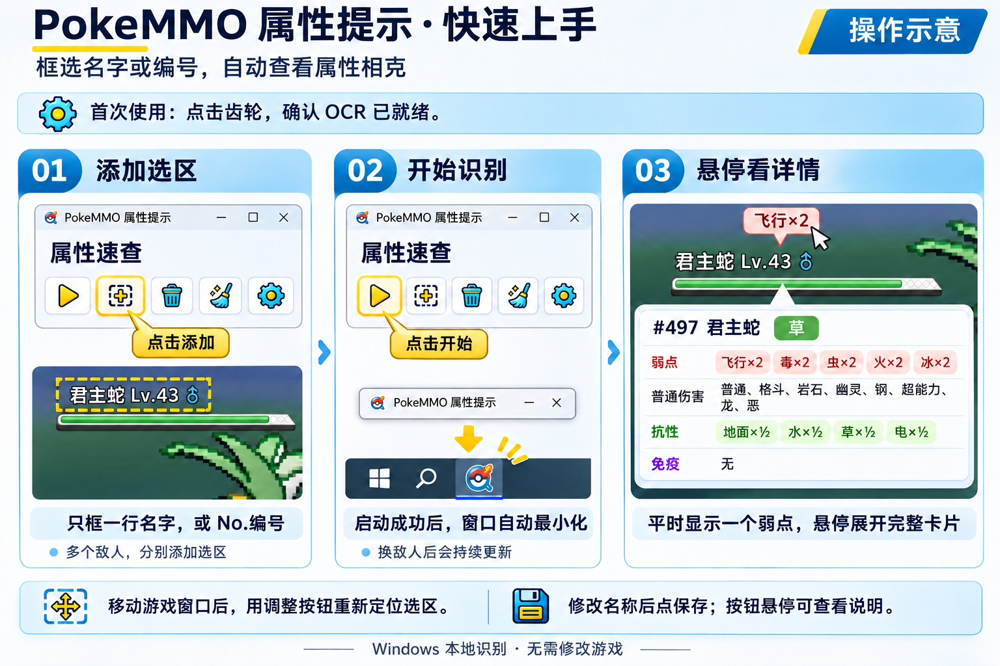

[简体中文](README.md) | **English** | [日本語](README.ja.md)

# PokeMMO Type Hint

A standalone Windows OCR helper. Select screen regions directly and locally recognize Chinese, English, or Japanese species names and `No.573` / `#573`, show the first weakness above each region, and expand the full type card on hover. The main window keeps the latest 20 recognition entries, newest first; click one to view that species. Interface and game OCR languages are configured separately (简体中文, English, 日本語). Regions can be named, dragged/resized, and are saved automatically; the recognition refresh rate is configurable, and the window minimizes after a successful start. Built with Rust, using the Windows system OCR and optionally PP-OCRv6 tiny, without modifying the game. It does not search for or inspect the PokeMMO process, so it also works with emulators, other Pokémon games, or Pokédex pages; recognition depends on the bundled data.

Covers base forms of National Nos. 1–649. Separate forms, ability/item modifiers, and live team scoring are not supported. Android is not implemented.



## Development

In Windows PowerShell, from the repository root:

```powershell
powershell.exe -NoProfile -ExecutionPolicy Bypass -File .\windows-ocr\setup.ps1
```

After changing the source:

```powershell
cargo run --release --manifest-path .\windows-ocr\Cargo.toml --offline
```

Regions are saved by screen position; after moving or resizing the game window, use the adjust button to reposition them. Regions from the older window-relative version must be selected again; old config files are kept. Only National Nos. 1–649 (base forms) and the Generation 2–5 type chart are supported.

Click the gear in the toolbar to open settings. Windows system OCR is the default (using the installed recognition feature for the game language) and ships no model. Choosing PP-OCRv6 tiny downloads a ~4.46 MB model and a ~17 MB inference runtime once. Models are fetched from `hf-mirror.com` by default, with an official-source option. After downloading they are cached locally for offline use; click the check mark to apply, and the choice is remembered on later starts. If the Windows OCR feature for the chosen language is missing, install it from the language settings button or choose PP-OCR.

Recognition uses grayscale upscaling, white-text extraction, and a binary fallback. PP-OCR's dictionary still lacks a few species characters, so not every name is guaranteed; candidate confirmation and number lookup remain available. The first download needs network access; screenshots are never uploaded.

[Full features, data, and validation (Chinese)](windows-ocr/README.md)

## Release

On a machine with Windows Rust and the MSVC build tools, exit the old program and run:

```powershell
powershell.exe -NoProfile -ExecutionPolicy Bypass -File .\scripts\release_windows.ps1
```

The script reads the version from `windows-ocr/Cargo.toml`, runs tests, compiles, and packages into `dist/`:

- `PokeMMO-Hint-v1.2.0-windows-x64.zip`
- `PokeMMO-Hint-v1.2.0-windows-x64.zip.sha256`

Upload these two files to a GitHub/Gitee release or send them directly. Users unzip the archive and double-click `pokemmo-hint.exe`. The base package does not include Tesseract, models, or ONNX Runtime; an installed Windows OCR language feature can be used as-is, and PP-OCR downloads on demand from settings. Users do not need Rust, a compiler, or a ROM.

To change the version, edit `version` in `Cargo.toml`, run `cargo generate-lockfile --manifest-path .\windows-ocr\Cargo.toml --offline` to sync the lockfile, then run the release script. Add `-Force` to repackage the same version. The script only creates local packages; it does not upload or push to Git.

[Packaging options, deliverables, and acceptance (Chinese)](docs/releasing.md)

## Repository layout

- `windows-ocr/`: application, icons, data, and setup/launch templates.
- `scripts/`: Windows release and local data import/audit tools.
- `docs/`: validation records and factual evidence.
