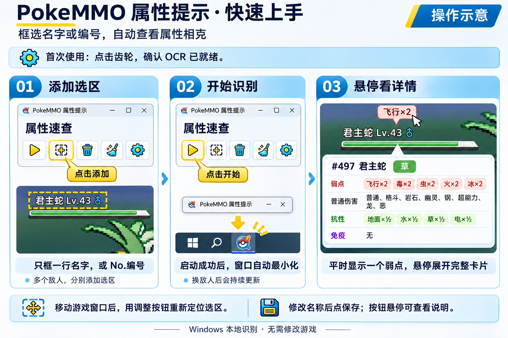

[简体中文](README.md) | [English](README.en.md) | **日本語**

# PokeMMO タイプヒント

独立した Windows 用 OCR 補助ツールです。画面を直接範囲指定し、その中の中国語・英語・日本語の種族名や `No.573`／`#573` をローカルで認識して、各範囲の上に最初の弱点を表示し、マウスを重ねると完全なタイプ相性カードを展開します。メインウィンドウ右側には最新 20 件の認識履歴を新しい順に保持し、クリックするとその種族の詳細を表示します。表示言語とゲーム言語（OCR・種族名の照合）は別々に設定できます（簡体中文・English・日本語）。範囲には名前を付けられ、ドラッグで移動・サイズ変更でき、自動保存されます。認識間隔も設定でき、開始に成功するとウィンドウは自動で最小化されます。Rust 製で、Windows 標準 OCR と PP-OCRv6 tiny（任意）に対応し、ゲームを改変しません。PokeMMO のプロセスを検索・検査しないため、エミュレーターや他のポケモンゲーム、図鑑ページでも使用できます。認識できるかどうかは同梱データに依存します。

全国図鑑番号 1–649 の基本形態に対応しています。形態ごとの個別認識、特性・道具による補正、リアルタイムのパーティ評価には未対応です。Android 版は未実装です。



## 開発時の実行

Windows PowerShell、リポジトリのルートで：

```powershell
powershell.exe -NoProfile -ExecutionPolicy Bypass -File .\windows-ocr\setup.ps1
```

ソース更新後：

```powershell
cargo run --release --manifest-path .\windows-ocr\Cargo.toml --offline
```

範囲は画面位置で保存されます。ゲームウィンドウを移動・拡大縮小した後は、調整ボタンで位置を合わせ直してください。旧版のウィンドウ相対座標の範囲は選び直しが必要です。旧設定ファイルは保持されます。現在も 1–649 の基本形態と第 2〜第 5 世代のタイプ相性のみ対応しています。

ツールバーの歯車から設定を開きます。既定では Windows システム OCR（ゲーム言語に対応する認識機能）を使用し、モデルは同梱しません。PP-OCRv6 tiny を選ぶと約 4.46 MB のモデルと約 17 MB の推論コンポーネントを初回のみダウンロードします。モデルは既定で `hf-mirror.com` から取得し、公式ソースにも切り替えられます。完了後はローカルにキャッシュされ、オフラインで認識できます。準備完了後にチェックを押して適用すると、次回起動時も選択が記憶されます。選択した言語の Windows OCR がない場合は、設定の言語設定ボタンからシステム機能をインストールするか、PP-OCR を選択してください。

認識にはグレースケール拡大、白文字抽出、二値化の代替処理を使用します。PP-OCR の文字表には一部の種族名の漢字がなく、すべての名前を正確に認識できる保証はありません。候補確認と番号検索は引き続き利用できます。初回ダウンロードにはネットワークが必要ですが、スクリーンショットは送信されません。

[詳細な機能・データ・検証（中国語）](windows-ocr/README.md)

## リリース

Windows Rust と MSVC ビルドツールが入った PC で、旧プログラムを終了してから実行します：

```powershell
powershell.exe -NoProfile -ExecutionPolicy Bypass -File .\scripts\release_windows.ps1
```

スクリプトは `windows-ocr/Cargo.toml` のバージョンを読み取り、テスト・コンパイル・パッケージ作成を `dist/` に対して行います：

- `PokeMMO-Hint-v1.2.0-windows-x64.zip`
- `PokeMMO-Hint-v1.2.0-windows-x64.zip.sha256`

この 2 ファイルを GitHub/Gitee の Release にアップロードするか、そのまま配布します。ユーザーは ZIP を展開し、`pokemmo-hint.exe` をダブルクリックします。基本パッケージには Tesseract、モデル、ONNX Runtime は含まれません。インストール済みの Windows OCR 言語機能はそのまま使用でき、PP-OCR は設定から必要時にダウンロードします。ユーザーに Rust、コンパイラー、ROM は不要です。

バージョンを変更する場合は `Cargo.toml` の `version` を編集し、`cargo generate-lockfile --manifest-path .\windows-ocr\Cargo.toml --offline` でロックファイルを同期してからリリーススクリプトを実行します。同じバージョンで再パッケージする場合は `-Force` を付けます。スクリプトはローカルにパッケージを作るだけで、アップロードや Git へのプッシュは行いません。

[パッケージ手順・成果物・受け入れ方法（中国語）](docs/releasing.md)

## リポジトリ構成

- `windows-ocr/`：アプリ、アイコン、データ、セットアップ／起動テンプレート。
- `scripts/`：Windows リリースとローカルデータの取り込み・照合ツール。
- `docs/`：検証記録と事実確認の証拠。
