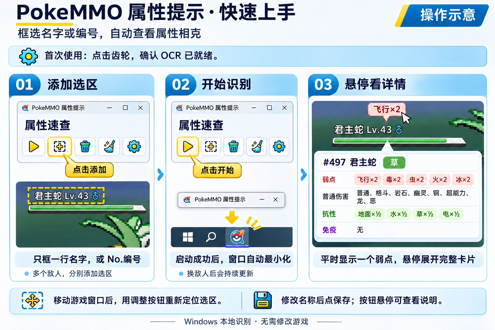

**简体中文** | [English](README.en.md) | [日本語](README.ja.md)

# PokeMMO 属性提示

独立 Windows OCR 辅助程序：直接框选屏幕，本地识别多个选区中的中文、英文或日文物种名与 `No.573`／`#573`，各选区上方显示首个弱点，悬停展开完整属性卡片。主窗口右侧保留最近 20 条识别历史，最新的在最上面，点击可查看该物种详情。界面与游戏识别语言可分别设为中文、English、日本語，支持命名、拖动调整和自动保存选区，可设置识别刷新率，开始成功后自动最小化。使用 Rust，支持 Windows 自带 OCR 和 PP-OCRv6 tiny，不侵入和修改游戏。无需查找或检测 PokeMMO 进程，可用于模拟器、其他宝可梦游戏或图鉴页面，识别能力取决于现有数据。

覆盖全国编号 1–649 的基础形态，尚不支持不同形态独立识别、特性／道具修正或实时队伍评分。Android 尚未实现。



## 开发运行

Windows PowerShell，项目根目录：

```powershell
powershell.exe -NoProfile -ExecutionPolicy Bypass -File .\windows-ocr\setup.ps1
```

更新源码后：

```powershell
cargo run --release --manifest-path .\windows-ocr\Cargo.toml --offline
```

选区按屏幕位置保存；移动或缩放游戏窗口后，可用调整按钮重新定位。旧版窗口选区需要重新框选一次，旧配置文件会保留。当前仍只支持 1–649 基础形态与第二至第五世代属性规则。

点击工具栏齿轮进入设置：默认使用 Windows 系统 OCR（按游戏语言选择识别功能），不携带模型；选择 PP-OCRv6 tiny 后自动下载约 4.46 MB 的模型和约 17 MB 的推理组件。HF 模型默认通过 `hf-mirror.com` 下载，可切换官方源。下载完成后缓存到本机，可离线识别；准备成功后点击对勾应用，后续启动记住选择。系统缺少对应语言的 OCR 时，可从设置里的语言设置按钮安装系统功能，或直接选 PP-OCR。

识别包含灰度放大、白字提取和二值化备选。PP-OCR 字表仍有少数物种用字缺失，不保证所有名字准确识别；保留候选确认和编号查询。首次下载需要网络，截图不上传。

[完整功能、数据与验证说明](windows-ocr/README.md)

## 发版

在装好 Windows Rust 和 MSVC 构建工具的电脑上，退出旧程序并运行：

```powershell
powershell.exe -NoProfile -ExecutionPolicy Bypass -File .\scripts\release_windows.ps1
```

脚本读取 `windows-ocr/Cargo.toml` 的版本号，测试、编译并打包到 `dist/`：

- `PokeMMO-Hint-v1.2.0-windows-x64.zip`
- `PokeMMO-Hint-v1.2.0-windows-x64.zip.sha256`

将这两个文件上传到 GitHub/Gitee Release 或直接发送即可。用户解压 ZIP，双击 `pokemmo-hint.exe`。基础包不包含 Tesseract、模型或 ONNX Runtime；已安装的 Windows OCR 语言功能可直接使用，PP-OCR 在设置中按需下载。用户不需要 Rust、编译器或 ROM。

后续修改 `Cargo.toml` 的 `version`，先执行 `cargo generate-lockfile --manifest-path .\windows-ocr\Cargo.toml --offline` 同步锁文件，再运行脚本。同版本重新打包可加 `-Force`。脚本只生成本地包，不自动上传或推送 Git。

[打包参数、交付清单与验收方法](docs/releasing.md)

## 仓库内容

- `windows-ocr/`：程序、图标、数据和安装／启动模板。
- `scripts/`：Windows 发版与本地数据导入、核对工具。
- `docs/`：验证记录与事实核对证据。

